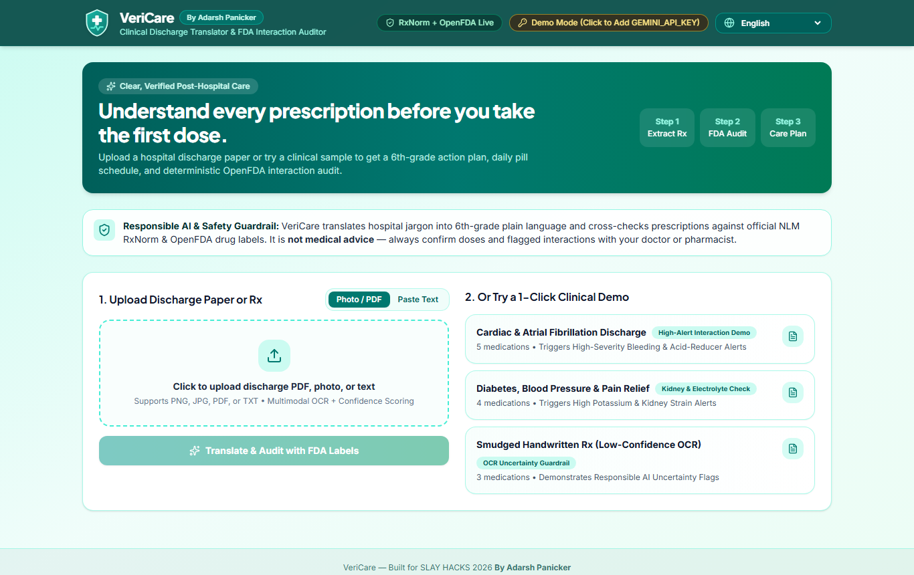
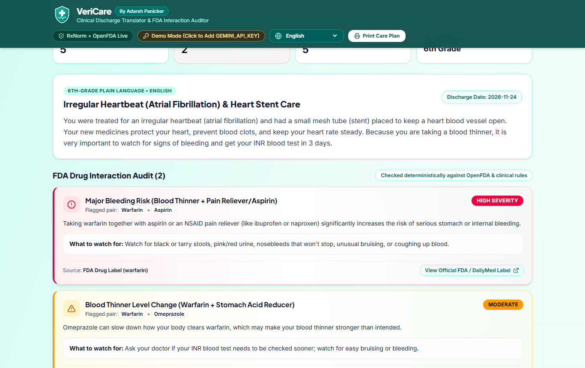
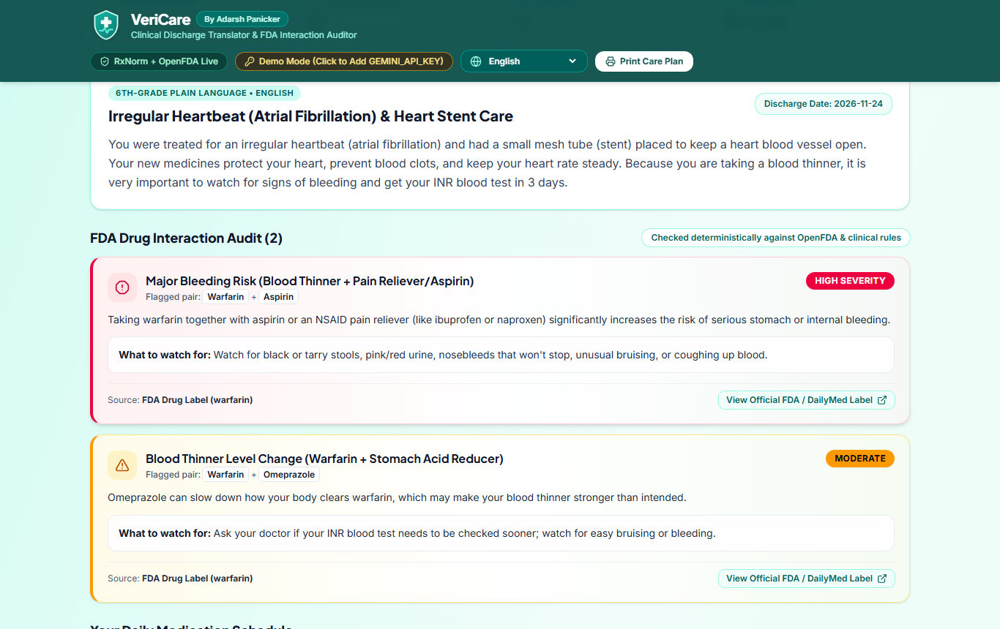
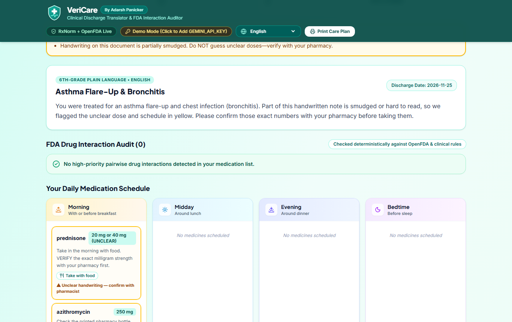

# VeriCare — Clinical Discharge Translator & FDA Interaction Auditor

**By Adarsh Panicker** • Built for **SLAY HACKS 2026**

VeriCare transforms dense hospital discharge summaries and handwritten or printed prescriptions into a **6th-grade plain-language care plan**, an **interactive 4-slot daily medication schedule**, and a **deterministic FDA drug-interaction audit** backed by official **NLM RxNorm** and **OpenFDA** drug labels.

---

## Screenshots

### Home & 1-Click Clinical Demos


### Deterministic FDA Drug Interaction Audit


### Color-Coded Daily Medication Schedule & Verified Drug Cards


### Responsible AI: OCR Uncertainty & Handwriting Guardrail


---

## Key Features
- **Multimodal Extraction (`Gemini 2.5 Flash`):** Upload a PDF, photo (PNG/JPG), or pasted text of a hospital discharge summary. Extracts medications, dosages, frequencies, timing slots, red-flag symptoms, follow-up steps, and per-field OCR confidence (`high`, `medium`, `low`).
- **Deterministic Clinical Verification (`NLM RxNorm` + `OpenFDA`):** Normalizes every medication to its canonical RxCUI, retrieves official FDA drug labels (`boxed_warning`, `warnings`, `drug_interactions`, `set_id`), and audits pairwise interactions deterministically—never relying on LLM guessing for drug safety.
- **6th-Grade Action Plan & 4-Slot Daily Schedule:** Organizes doses into **Morning**, **Midday**, **Evening**, **Bedtime**, and **As Needed (PRN)** with food/timing guidance, interactive follow-up checklists, and 1-click printable care plans.
- **Live Multilingual Translation:** Supports **English, Spanish, Hindi, Arabic, French, and Mandarin Chinese**—translating active care plans in-place alongside localized UI headings.
- **Responsible AI Guardrails:**
  - Persistent **"Not Medical Advice"** clinical disclaimer.
  - Explicit amber uncertainty banners when handwriting/OCR confidence is low or smudged.
  - Direct **DailyMed / OpenFDA** label links on every interaction alert and medication card.
  - Secure, masked server-side modal in the header to configure `GEMINI_API_KEY` without storing or exposing the key in browser storage.

---

## Tech Stack
- **Frontend:** React, TypeScript, Vite, Tailwind CSS, Lucide Icons
- **Backend:** Python, FastAPI, Pydantic v2, HTTPX, `google-genai`
- **Clinical Data APIs:** NLM RxNav/RxNorm REST API & OpenFDA Drug Label API

---

## Quick Start

### 1. Backend (FastAPI)
```bash
cd backend
cp .env.example .env   # Optional: add GEMINI_API_KEY (or enter it in the UI header modal)
python -m pip install -r requirements.txt
python -m uvicorn app.main:app --reload --port 8000
```

### 2. Frontend (React + Vite)
```bash
cd frontend
npm install
npm run dev
```

Open `http://localhost:5173`. Even without a `GEMINI_API_KEY`, the **3 built-in 1-click Clinical Demos** run live against the NLM RxNorm and OpenFDA APIs.

---

## Running Tests
```bash
cd backend
python -m pytest -v
```
